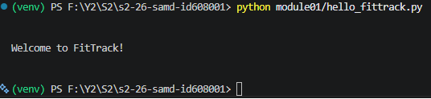

# Module 1

## Task 1 - js vs py
_what's identical, and what's just different syntax for the same idea?_

The naming schema used is different between the languages. Python uses pascal case while Javascript uses camel case. Javascript uses console.log instead of print statements. Javascript also uses curly braces while python relies on indentation and colons. The string interpolation is also different, python uses fStrings with curly braces around variables names while javascript uses backticks with a dollar sign then the variable name in curly braces. 

They both use the same syntax for the method arguments and return keywords.


## Task 2
Video:
[Walrus Operator Explanation and Examples](resources/AD2-M1-T2-Final.mp4)

Code Snippet:
```python

def main():
    # Stream lining while loops
    while (line := input("Enter something: ")) != "quit":
        print(line)

    # This removes the need to have a while (True) loop with a break i.e:

    while (True):
        line = input("Enter something: ")
        if (line == "quit"): 
            break
        else:
            print(line)


    # Can also be used to optimize if statements
    # Optimizing if statement

    # Without walrus
    foo = get_bar()
    if foo:
        print(f"{foo}")
        # Do something with foo

    # With walrus
    if foo := get_bar():
        print(f"{foo}")
        # Do something with foo

def get_bar():
    return "bar"    

if __name__ == "__main__":
    main()
```

## Task 3

```python
def main():
    print("\n")
    print("Welcome to FitTrack!")
    print("\n")

if __name__ == "__main__":
    main()
```

