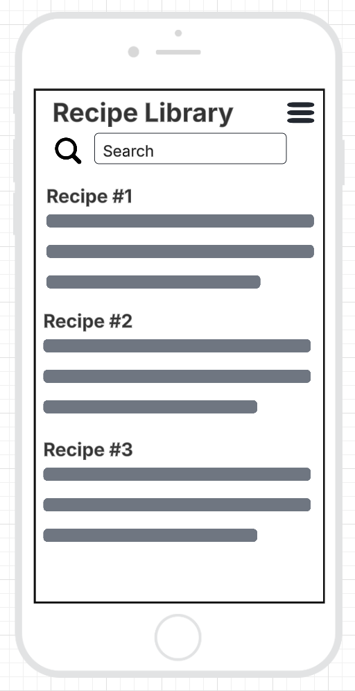
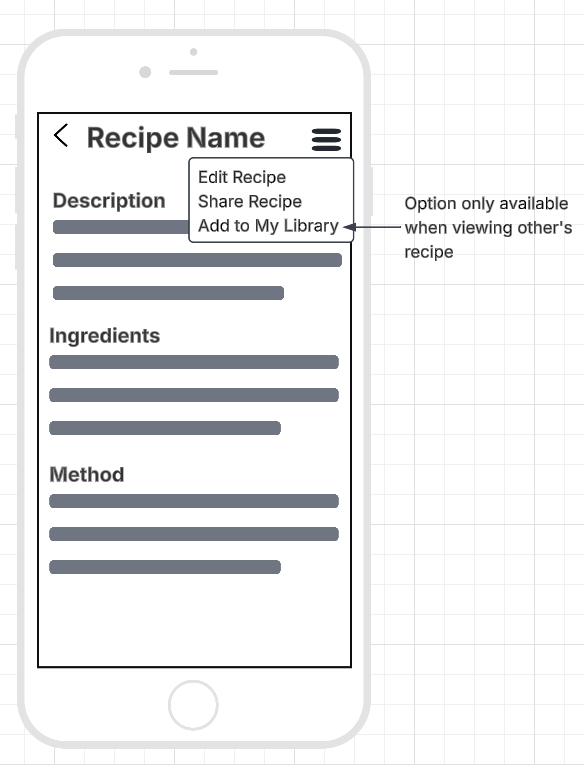
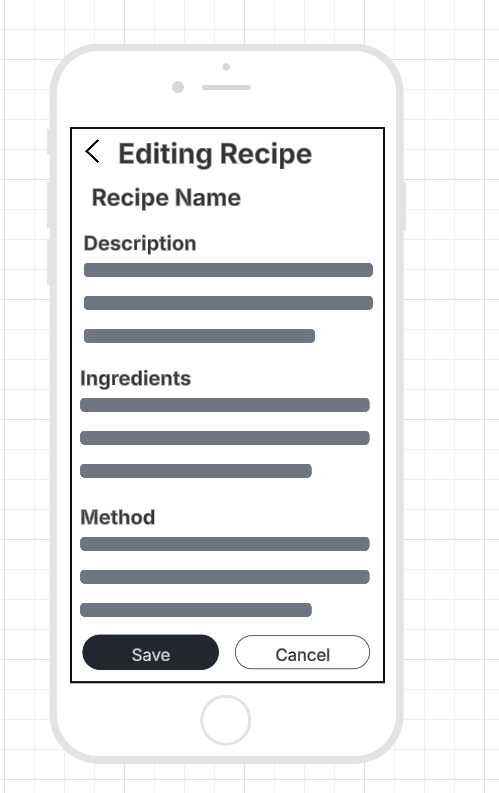
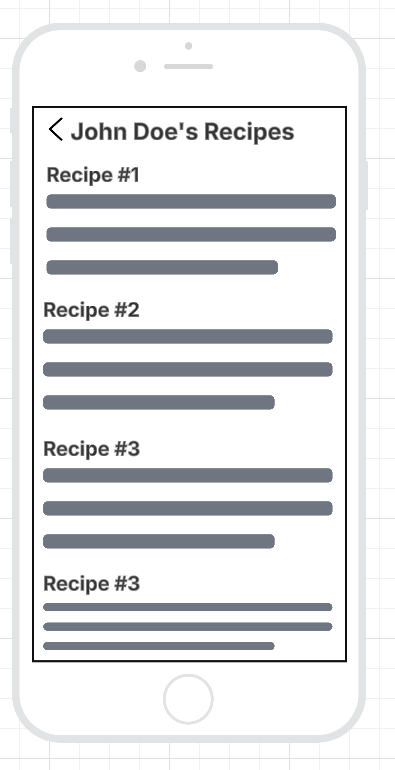
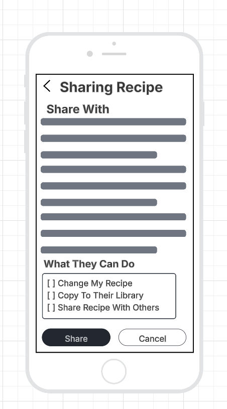

# My Recipe Book

## Purpose
The Purpose of this app is to store people's recipe books digitally so that they can easily search for that one receipe that they always struggle to find.
With this app you will also be able to get a recipe that uses a certain ingredient, so that you can use those bananas that are getting a little too ripe and turn them into a delicious banana cake.
You will also be able to share recipes and invite people to view your recipe book library - meaning Grandmas recipes don't get lost when she downsizes!

## Target Audience
Anyone who loves to bake or cook, from Grandma to the Grandkids, if they have a phone and a recipe, then they can use this app.
Not intended for commercial environments, but companies and resturants could share recipes on it.

## Core Features
- Store Recipes
- View Recipes
- Share Recipes
- Control Access to your recipes
- Search for a recipe using ingredients

## Screen Designs

### Viewing Recipe Library

### Viewing a Recipe

### Editing a Recipe

### Viewing Someone Else's Recipe

### Sharing a Recipe With People

## Navigation
Navigation will primarily be with the back button in the top left. 
The Recipe library will be the home screen.
There will be a small context menu button in the top right to control additional functions for the current screen.
Because this app is aimed at people's of all age ranges, the app's navigation needs to be simple and easy to understand for both elderly and young alike.

## Design Choices

### Colour scheme
The colour scheme will be plain and basic so as to not distract from the information in the recipes and support people with poor eyesight.

### Fonts
The fonts will be large and clear so that people with poor vision can easily read and understand the recipes without having to strain to read.
 
### Icons
The icons will be minimal as this app is more aimed at making the recipe information clear

### Overall Style
The overall style will be minimalistic to not distract from the recipes and the information in them.
This style choice is to also support the elderly or people with poor eyesight.