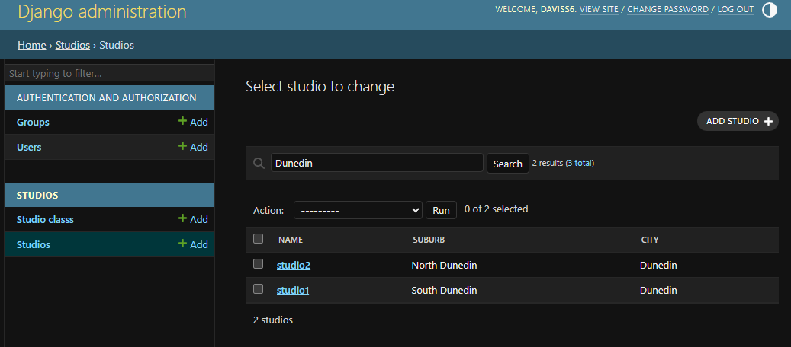

# Module 2

## Task 3
What Studios are in Dunedin?

I added the city and suburb fields from the Studio model to the StudioAdmin search_fields property.
I then used the search bar to search for Dunedin.
Results:

## Task 4
I have added the ordering option to the StudioClassAdmin this is so that I can order them by what studio they are in.

I tried an extra value of -1 in my StudioClassInline. This makes adding data awakward as there is always one less studioclass entry than the studio actually has. A default value of 1 means that there is always an empty line to add more studio classes to a studio